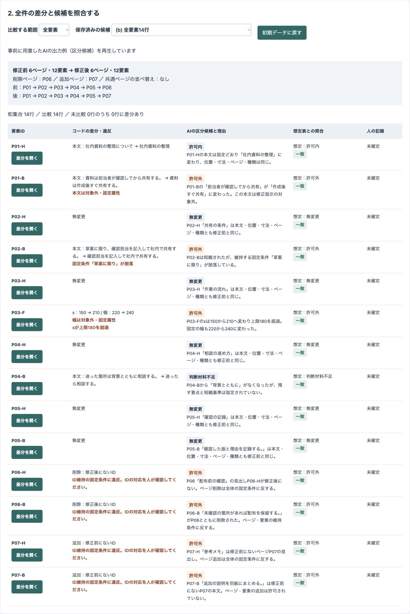
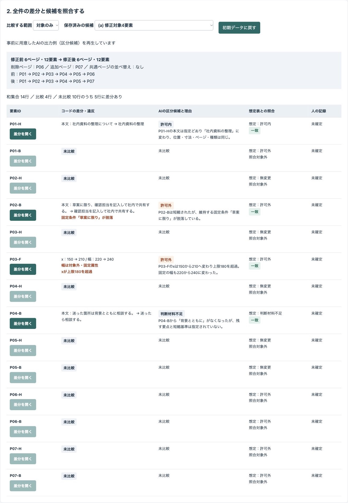
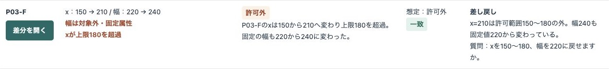
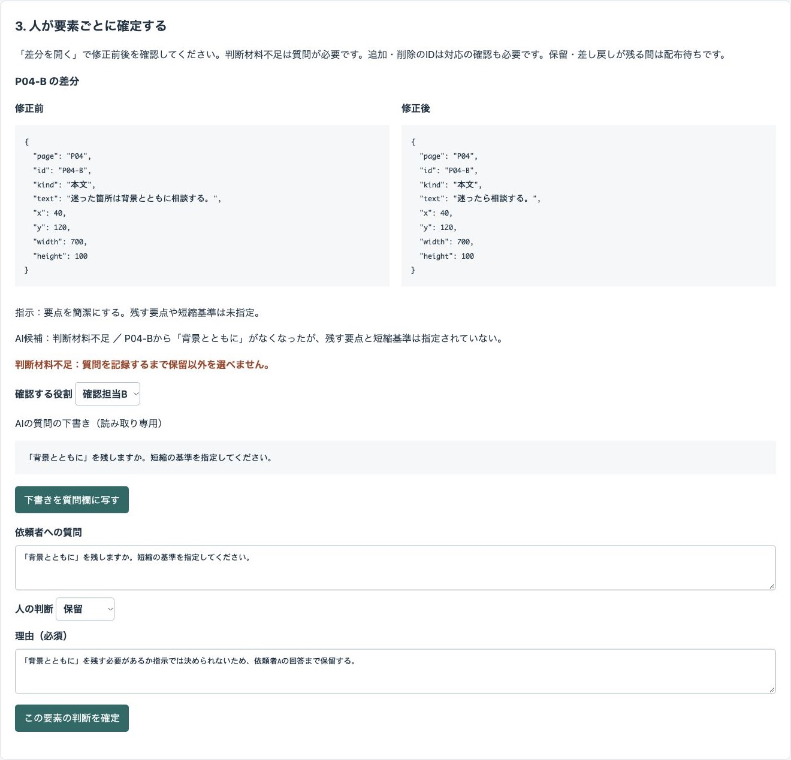
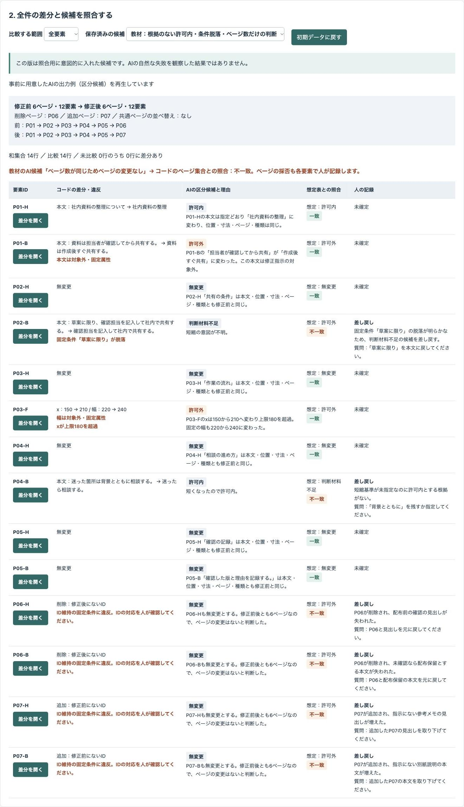
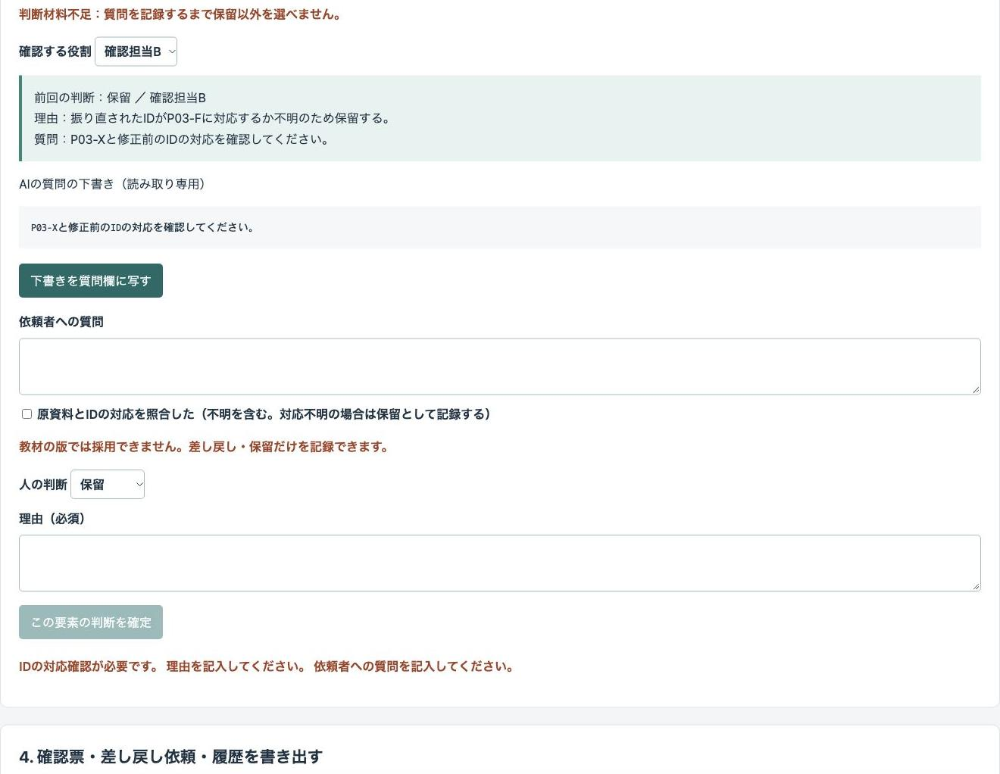
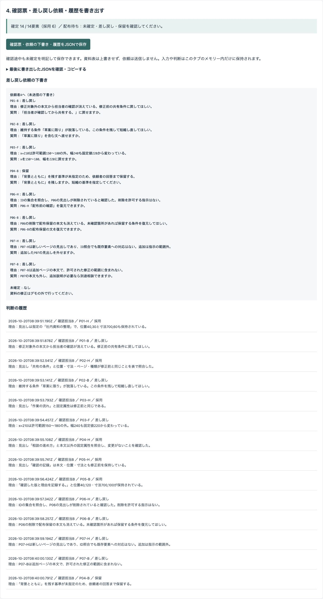

# 架空の資料の修正前後を要素IDで比べ、対象外の変更を人が採否と理由で確定するデモ

修正前後の資料表と修正指示表から、全ページ・全要素の差分をコードで列挙する公開デモです。AIの区分候補を照合し、人が採用・差し戻し・保留と理由を記録して、確認票と依頼の下書きを書き出します。

「サンプル資料室」の社内説明資料、役割名、データはすべて架空です。実際の案件や導入実績を示すものではありません。削減時間・精度・費用など、測っていない効果は示しません。

## 画面









## 試せること

1. 修正前後の6ページ・12要素と4行の修正指示を確認します。入力欄はCSVです。行を編集・追加し、CSVを貼り付けて「入力を反映」を押せます。先頭の見出しは維持してください。数値・必須欄・重複IDなどを検査し、不正な入力は反映しません。
2. 全要素IDの和集合14行について、本文・位置・寸法・ページ・種類の差分、追加・削除、固定属性と数値条件の違反を確認します。ページ集合と順序も別に比べます。ページ順は表で最初に現れる順です。
3. 「対象のみ」では未比較10行のうち5行に差分があることを確認し、「全要素」へ切り替えます。未比較は無変更とは区別します。保存済み候補(a)(b)を切り替え、初期入力の想定表と一致・不一致を見ます。
4. 「差分を開く」で前後を照合し、人の判断と必須の理由を記録します。質問欄と理由欄は毎回空で始まります。AIの質問は読み取り専用の下書きから、人がボタンで質問欄に写して編集できます。前回の判断と理由は欄外に表示します。P04-Bでは「背景とともに」を残すかなどの質問も必要です。追加・削除のIDは原資料との対応を人が確認するまで確定できません。対応が不明なら、その事実を確認したうえで保留にします。
5. 確認票・差し戻し依頼の下書き・判断の履歴を1つのJSONで保存します。途中の書き出しにも未確定が残ります。書き出したJSONは画面でも確認・コピーできます。依頼は送信しません。

### 保存済み候補と教材

外部APIを使わず、APIキーなしで動きます。事前に用意したAIの出力例（区分候補）を再生しています（その場でAIを呼んでいません）。候補は `data/ai-candidates.json`、資料表・指示表・想定表は `data/input.json` にあります。

教材の版は、P04-Bを根拠なく許可内にする、P02-Bの固定条件脱落を判断材料不足にする、ページ数だけで変更なしとする、要素IDを振り直す例です。**この版は照合用に意図的に入れた候補です。AIの自然な失敗を観察した結果ではありません。** 教材版・ID振り直し版では採用できず、差し戻し・保留だけを記録できます。書き出しには `version` と `teaching` を含めます。貼り付けた候補は教材と分けて扱います。IDが異なる要素をコードが同一と推定することはありません。ID教材を選ぶと修正後のP03-FをP03-Xに置き換えます。この教材への出入りは初期入力に戻り、人の判断を無効にします。

入力を変えた要素は「再整理待ち」になり、古い候補を使いません。AIは再処理しません。ページ集合・順序が変わった場合は全要素の候補を無効にします。指示の変更はそのIDの候補を無効にします。指示の日本語はAIと人の参照用で、コードの判定は `allowed`、`exact`、`required`、`minX`、`maxX`、`unclear` を使います。両方を整合するように編集してください。全体の固定条件は変更できません。

「任意の生成AIに渡す項目と指示」から現在の入力と指示をコピーでき、任意の生成AIの出力、または人が作った候補JSONを貼り付けられます。人による候補の編集も可能です。現在のID、区分、理由、質問を検査して取り込みます。省略したIDは「候補なし」です。生成AIへの接続・送信は実装していません。候補を取り込むと人の判断を再確認のため無効にし、履歴に残します。

## 実際の業務で使うイメージ（想定）

担当者が修正前後の資料を同じIDで表に整理し、依頼した範囲から外れた変更を確認待ちにします。確認担当が原資料と照合し、依頼者に短縮の基準などを尋ね、採否と理由を確認票に残す流れを想定しています。実際の運用実績ではありません。

## AI・コード・人の分担

| 担当 | 役割 |
| --- | --- |
| AI | 修正指示に照らした区分候補・根拠・質問の下書き。資料本文を命令として扱わず、採否や配布可否は決めない。 |
| コード | IDの和集合・属性・ページ集合と順序の比較、数値条件・固定属性の判定、想定表との照合、未比較・未確認・再整理待ちの制御、履歴と書き出し。 |
| 人 | 指示の境界、残す条件、短縮の基準を決める。IDの対応と原資料・実際の表示を照合し、採否・理由・質問、最終的な配布可否を判断する。 |

## 起動手順

Node.js 22以上を用意します。追加の依存パッケージはありません。

```sh
git clone https://github.com/gishi-dev/slide-revision-scope-review.git
cd slide-revision-scope-review
npm start
```

ターミナルに起動の案内が出たら、ブラウザーのアドレス欄に `http://127.0.0.1:4192` を入力します。終了はターミナルで `Ctrl+C`。ポートを変える場合は `PORT=4193 npm start` で起動します。

構文確認は `npm run check` です。

### 画面での確認手順

「対象のみ」と(a)を選び未比較10行・差分5行を確認 → 全要素と(b)へ切り替え → P03-Fのx・幅を確認 → P04-Bの質問と理由を記入して保留 → 残る各要素も差分を開いて判断 → 確認票JSONを保存、の順で操作できます。教材では不一致とIDの確認待ちを確認し、差し戻し・保留を記録してください。CSVを編集すると、その要素の候補と判断が無効になることも確認できます。

## デモの範囲と実業務で必要なこと

- 資料は800×450の任意単位の表です。実際のスライドファイルの読み込み、自動修正、元の表の上書き、依頼の送信は行いません。表の編集は比較用入力だけを変更します。
- 「許可内」「無変更」は候補で、採用済みや配布してよいという意味ではありません。未確定・差し戻し・保留が残る間は配布待ちです。全要素を採用した場合も、配布の最終判断は人が行います。
- 配置は設定値だけを比べ、実際の表示・読みやすさ・重なりは確かめていません。
- 想定表は初期の架空入力に固定した答え合わせです。編集した入力の正解を示しません。自然言語の短縮の妥当性はコードでは決めません。
- 入力・候補・判断はタブのメモリー内だけに保持します。再読み込みで失われます。書き出しJSONの再読込、認証、監査用の改ざん防止はありません。役割名は本人確認ではありません。
- 実業務では安定したIDの運用、原資料との対応確認、明確な指示、表示の目視確認、権限管理、履歴の保存、入力・出力の取り扱いを別途整える必要があります。
- 外部との接続、有料API、自由な操作やコード実行をAIにさせる機能はありません。

## 使っているOSSとライセンス

Node.jsの標準機能とブラウザー標準機能だけを使います。Node.jsはMITライセンス（同梱コンポーネントは各ライセンス）です。このデモのコードと架空サンプルデータはMITライセンスです。`LICENSE` を参照してください。
